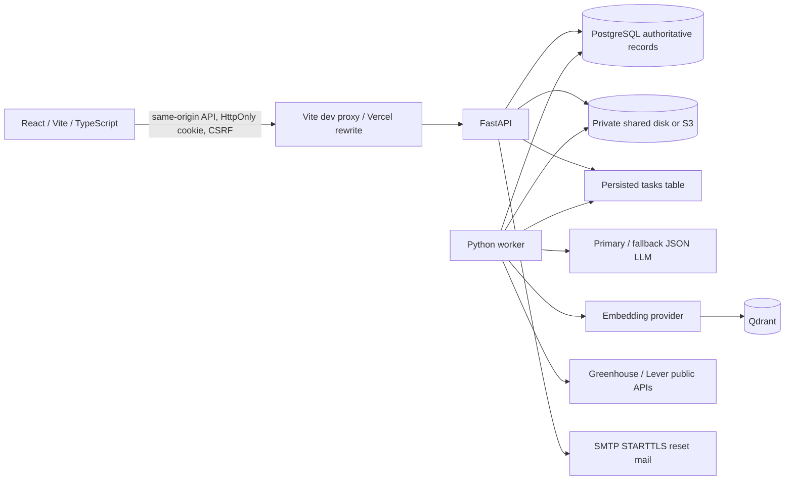
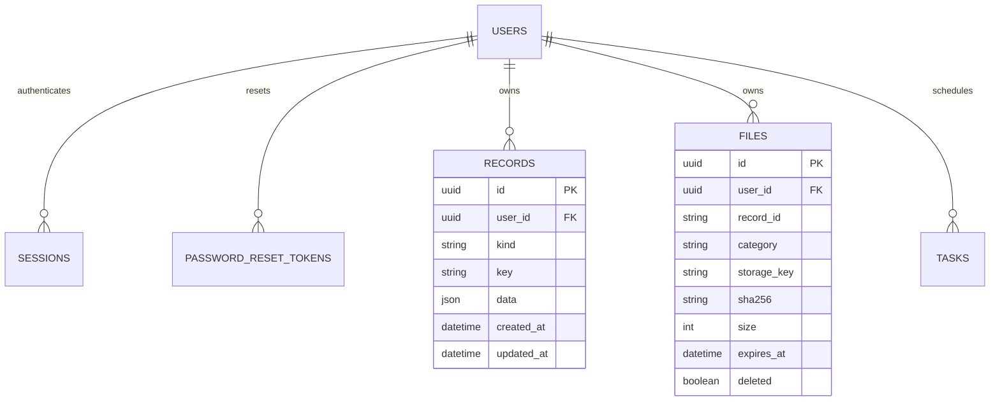
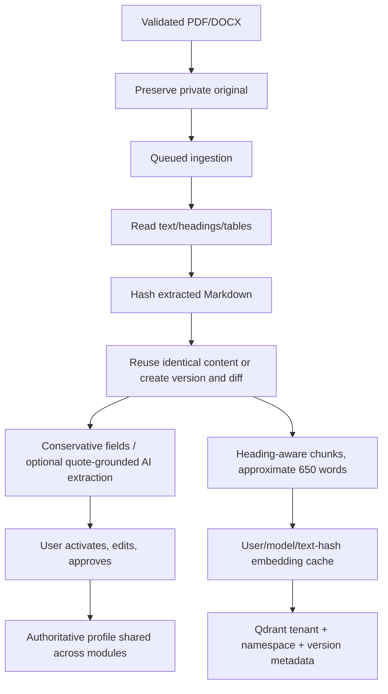

# Career Assistant architecture

Status: implemented local system with service adapters; production integrations and deployment remain unverified. This document describes actual code and explicitly identifies trade-offs.

## Decisions

| Concern | Choice and reason | Alternatives/trade-offs |
| --- | --- | --- |
| Frontend | React, TypeScript, Vite. Fixed Amber Desk light-mode theme, shared feature UI. | No server-rendered frontend required. Tables scroll horizontally because all specified columns remain present. |
| Backend | FastAPI validated routes, SQLAlchemy 2 persistence, continuously running Python worker. | Containers/long-lived Python avoid serverless runtime limits for generation. |
| Authority | PostgreSQL in production. SQLite only for development/tests. | JSON records keep domain evolution compact but have weaker domain-specific SQL constraints than a fully normalized 25-table schema. |
| Vectors | Qdrant: persistent, explicit payload filters, remote deployment, optional local/free hosting. | Chroma is convenient embedded development; Qdrant fits separate API/worker hosts. Neither is a free hosted-service guarantee. |
| Embeddings | Configurable `text-embedding-3-small`, model-specific collection and per-user hash cache. | Larger embeddings or locally hosted models need quality/cost/latency benchmarks, not assumed superiority. |
| Generation | Configurable OpenAI-compatible primary/fallback; example defaults GPT-5.1 / GPT-4.1. | No live model benchmark or account entitlement established. Same-provider fallback does not protect against an account-wide outage; configure a second provider for that. |
| Orchestration | LangGraph generation → validation. Deterministic sorting/dedup/scoring remain ordinary code. | No CrewAI multi-agent overhead. Task durability is implemented in SQL; LangGraph itself has no durable checkpointer here. |
| Binaries | Private disk volume or optional S3 adapter; temporary render files separate from originals. | Stateless deployments need shared persistent storage. Direct authenticated downloads avoid bearer links. |

Official references: [Qdrant multitenancy](https://qdrant.tech/documentation/manage-data/multitenancy/), [LangGraph overview](https://docs.langchain.com/oss/python/langgraph/overview), [OpenAI embeddings](https://developers.openai.com/api/docs/guides/embeddings), [OpenAI text generation](https://developers.openai.com/api/docs/guides/text), [Greenhouse Job Board API](https://docs.greenhouse.io/job-board), [Lever Postings API](https://github.com/lever/postings-api), [Vercel rewrites](https://vercel.com/docs/routing/rewrites).

## Modules and data contracts

`frontend/src/App.tsx` implements authentication, navigation, jobs, resume library, profile review, interview studio and Settings. `AmberPreview.tsx` holds the single selected-theme preview with labelled illustrative data. No theme selector remains. `DocumentEditors.tsx` edits content and required-document declarations. `api.ts` centralizes cookie/CSRF requests and blob downloads; `viewLogic.ts` provides tested selection, paging and UTC formatting helpers. Current UI decomposition should be expanded into per-feature modules as the application grows.

`backend/app/main.py` exposes typed API models and tenant checks; `security.py` handles authentication/rate limiting; `db.py` defines relational tables and migration; `resumes.py` extracts and normalizes facts; `rag.py` indexes/searches user knowledge; `jobs.py` discovers, classifies and scores jobs; `ai.py` handles bounded primary/fallback calls and LangGraph validation; `interviews.py` implements category batches and guide structures; `rendering.py` converts saved content; `storage.py` enforces private paths and cleanup; `workflows.py` claims/processes persisted jobs; `worker.py` runs queue processing and expiry sweeps.

FastAPI's generated OpenAPI contract is at `/openapi.json` or `/docs`. Frontend contracts are presently hand-maintained and require integration checks when changed. No shared generated TypeScript client has been supplied.

## Database schema

Other tables: `rate_limits` for persistent throttle counters and `schema_versions` for initial migration tracking. `records` has `(user_id,kind,key)` uniqueness and tenant/kind indexes. Kinds include resume, profile, job, preferences, research, knowledge, embedding, content, content_version, interview_batch, interview, mock_session and audit. Application state/history and match/verification/sponsorship objects live in job JSON. Generated text is relational JSON/Markdown; file bytes never enter Qdrant. Record references inside JSON/file metadata do not have domain-level foreign-key constraints. This is an explicit deviation from the recommended normalized schema, not equivalent production data-integrity coverage.

## Authentication and isolation

Email/usernames are stored lowercased with unique constraints. Argon2id hashes passwords; dummy-hash verification hides missing usernames. Cryptographically random session/reset tokens are stored only as SHA-256 hashes. HttpOnly/Lax cookies are secure in production; mutating authenticated endpoints require an in-memory CSRF token and matching origin when provided. Server-side lookup scopes every domain record/file/task by authenticated user. Logout removes the current session. Password reset is single-use, expires in 30 minutes, and invalidates all account sessions. Reset messaging is generic; SMTP delivery timing is not equalized.

Rate limits use atomic PostgreSQL/SQLite upserts with conditional window resets, including concurrent first-use creation. Production concurrency/load verification is still required. Production reverse proxy trust must be explicitly configured; the default rejects proxy headers so arbitrary forwarded IPs cannot bypass limits. Edge throttling is recommended for reliable client-IP limits at scale.

Account deletion verifies the password, blocks while tasks are running, removes tenant vectors/files and cascades relational rows. This is not a transactional distributed delete: interruptions after some remote deletions need operational retry support. No recovery window is implemented.

## Resume ingestion and RAG

The requested 400–800 token target is currently approximated using word counts; oversized semantic sections remain intact to avoid breaking career context. This is deliberate context preservation, not measured token-aware chunking. Embedding cache avoids repeating calls for unchanged chunk text; points use stable tenant/namespace/text IDs and retain version membership arrays. Retrieval always filters user, namespace, active version. Lexical-only mode is labelled explicitly if semantic services are absent. Old versions/facts remain stored; active-version filtering deactivates removed facts. Profile generation supplies the full candidate profile when needed.

## Discovery, evidence and matching

Public board adapters enumerate configured employer boards, collect publication evidence/time, extract JD text, filter India/eligible international locations and merge deduplicated records. They do not search the entire market or assert third-party jobs were found on company websites. Manual records carry user-provided evidence labels. Positive sponsorship sentences and negative/conditional exclusions are deterministic heuristics; country ambiguity excludes listings from main visa results. Regions/countries from AI research are saved suggestions only. Job RAG namespace indexing for discovery evidence is not yet fully integrated.

Matching uses requested 30/20/15/15/10/5/5 weights. Structured requirements contribute mandatory/preferred/experience/domain/responsibility/eligibility evidence; missing components score zero. Skill mentions fall back to a known-skill vocabulary and must not be interpreted as a complete JD requirement analysis. Explainable details are visible in the job dialog. Default sorting uses descending fit, NOT APPLIED, relevant date, deterministic ID. Retention filters active results after 60 days, preserving all stored history.

## Applications

Bulk preparation checks user ownership, previous status, declared mandatory requirements, approved generated content and typed attachments, and returns per-job validation outcomes. Without an employer-authorized connector it returns the external application workflow. The UI opens employer URLs only after review and records user-supplied confirmation receipts separately from manual status edits. The optional Greenhouse connector requires an employer API key and explicit user confirmation. The worker revalidates the published requisition and required standard fields, sends current approved content/typed attachments, and records APPLIED only on an explicit success response. Additional answers/legal consent require employer-site completion. Persistent attempts block replay after uncertain outcomes; validation failures can be retried after correction. Rendered connector documents are held in request memory, so cleanup cannot remove files during transmission. No CAPTCHA bypass occurs. Real employer submission access and acceptance are unverified.

## Generation, review and rendering

Content cache keys bind profile/resume, job identity/company/title/country/JD and prompt version. Primary/fallback JSON calls are bounded to one attempt per provider. Untrusted resume/JD instructions are separated into data; the model has no tools. Structural validators reject incomplete documents/questions. This mitigates prompt injection but cannot formally guarantee semantic truth or eliminate malicious input effects. Generated claims require user review. AI token usage returned by the provider is stored with content; there is no billing dashboard or enforced user budget yet.

Generated content records include type, structured sections, Markdown, source resume, JD hash, model/prompt/version/time/hash and validation status. Edits preserve prior content records and expire old render files. Approving text enables application-document rendering. DOCX, PDF, escaped LaTeX and ZIP come exclusively from persisted text; cache hits and format conversions never invoke the LLM. PDF layout is direct ReportLab rather than LaTeX compilation. Interview guides flatten their structured question/plan material into export sections, retaining coding and follow-up answers as readable text.

## Worker and lifecycle

SQL tasks persist queued/running/completed/failed status and result/error. PostgreSQL `FOR UPDATE SKIP LOCKED` serializes task claims. A two-hour stale task lease becomes failed rather than replaying expensive/uncertain side effects automatically. Partial interview category batches remain reusable. SQLite supports only a single development worker; distributed load/restart/lease tests remain outstanding. There is no heartbeat renewal for tasks exceeding the lease, so production generation limits and resumable leases need hardening.

Temporary binaries expire at creation+24h. API enforces expiry even if cleanup is delayed. Worker sweeps once per minute, tombstones metadata after successful object deletion, and removes old local temporary orphans. Original uploads/attachments are outside the sweep. Saved structured text is never expired by generated-file cleanup. Local per-tenant storage keys are UUID based and user filenames are sanitized. S3 adapter uses private requests, encryption flags and authenticated API downloads; production IAM/bucket lifecycle settings remain operator responsibilities.

## Deployment and operational limits

Vercel serves the static Vite build and rewrites same-origin `/api` calls to the separately hosted backend. A disconnected preview includes an explicit 503 API handler and a frontend notice. Dockerfile and Compose provide API/worker/PostgreSQL/Qdrant/private-volume wiring; containers and live external services were not available for verification. The initial schema migration is idempotent creation, not a complete alteration-migration framework.

Before launch: provision actual services; authenticate deployment through permitted tooling; configure source boards/secrets/email; validate PostgreSQL constraints/Qdrant filters/S3 privacy; test real AI quality and facts; implement permitted automated submission if required; address remaining requirement gaps and concurrency/security hardening; run end-to-end production acceptance. Never mark the application production-ready merely because frontend assets build or deploy.

Final appearance: **Amber Desk only**. All alternative theme assets and switching controls are removed. Preference data migration 002 preserves existing search settings.
